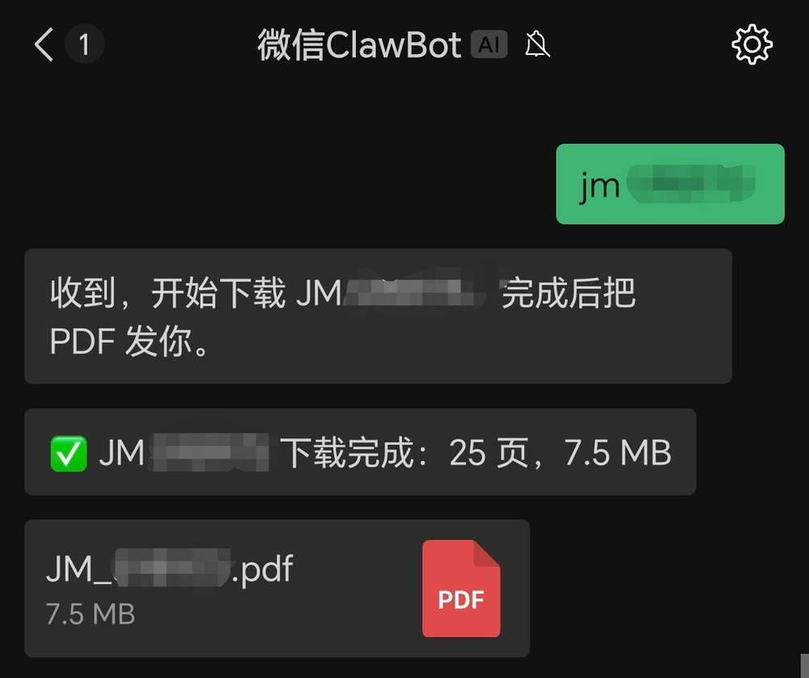

# 微信 JM 命令桥（Linux / DSHA 容器版）

在微信里发 `jm <id>`，机器自动用 jmcomic 下载、合并成 PDF、再通过微信把文件回给你。
**全程不调用任何大模型**，零 token。

这个包是从原 Windows 便携版改出来的，去掉了 PowerShell / 计划任务依赖，改成
Linux / Android（DSHA Ubuntu 容器）能直接跑的形式，并补了几个实用行为：

- 启动成功后给微信发一条「✅ 已就绪」，收到就说明链路通了
- 下载超过 3 分钟，每 3 分钟回报一次「已落 X 页，已用 Y 分钟」
- PDF 发出去之后才删原图（发送失败则保留，方便重发）
- ID 不存在/不可见时回一句人话，而不是「合并失败：目录不存在」
- 同一本重复发只回旧 PDF；按消息 ID 去重；白名单只认绑定账号；单实例锁
- 日志里用北京时间（容器没 tzdata，用 `TZ=UTC-8` 固定偏移）

## 实际效果

微信里发一条 `jm <id>`，bot 回下载进度和 PDF：



## 环境要求

- Linux，或者 Android 上跑 [DSHA](https://github.com/DSH-APP/DSHA)（Ubuntu 容器）
- Python 3.9+
- 能访问 `ilinkai.weixin.qq.com`（微信 bot 接口）和 JM 的图片 CDN
- 一个微信账号用来扫码绑定（建议小号）

## 安装

```bash
unzip jm-weixin-bot.zip
cd jm-weixin-bot
bash install.sh
```

`install.sh` 会：装依赖（jmcomic / Pillow / pycryptodome / segno）→ 建漫画库
`$HOME/JM_Downloads` 和 `option.yml`（`Bd / Aid` 规则）→ 如果有 DSH，顺手把 skill
装到 `~/.dsh/skills/jm-weixin-bot`。

## 启用微信 clawbot 插件（首次必做）

这个 bot 走的是微信的 clawbot 通道，手机微信要先能看到这个插件：

1. 把微信**升级到最新版本**；
2. **完全关掉微信**（从最近任务里划掉，或直接杀进程），再重新打开；
3. 进「我 → 设置 → 插件」，确认里面能看到 **微信clawbot**；
4. 如果没看到：**再杀一次微信进程**，重新打开再看一次（还不行就先确认微信真的是最新版）。

看到这个插件之后再往下扫码；否则扫完码在微信里可能找不到 bot、或者发消息没反应。

## 绑定微信（只做一次）

```bash
cd skill/scripts
python3 send_weixin.py --login-server --port 18791
```

浏览器打开 `http://127.0.0.1:18791/`（手机上的话直接开这个地址），用要绑定的微信扫码，
页面会显示「✅ 登录成功」。凭证会写到 `~/.dsh/weixin/accounts/`。

> 同一个 bot 只能有一台机器常驻。两台同时跑会抢消息（谁先取走算谁的）。

## 启动

```bash
bash start-bot.sh            # 启动
bash start-bot.sh status     # 看状态和最近日志
bash start-bot.sh stop
bash start-bot.sh restart    # 改过脚本后用这个
```

启动后微信会收到「✅ JM bot 已就绪」。

## 自动启动

### DSHA / DSH 环境（本包附带）

```bash
bash autostart/enable-autostart.sh     # 容器每次启动自动拉起 bot
bash autostart/disable-autostart.sh    # 还原
```

原理：把 `/usr/local/bin/dsh` 换成包装脚本，先跑 `start-bot.sh start` 再 `exec` 真正的
`dsh`。DSH 升级/重装可能覆盖这个软链，到时重跑一次 `enable-autostart.sh` 即可。

### 普通 Linux（systemd）

```ini
# ~/.config/systemd/user/jm-weixin-bot.service
[Unit]
Description=WeChat JM bot
After=network-online.target

[Service]
Type=simple
Environment=TZ=UTC-8
Environment=JM_ROOT=%h/JM_Downloads
WorkingDirectory=%h/jm-weixin-bot/skill/scripts
ExecStart=/usr/bin/python3 %h/jm-weixin-bot/skill/scripts/weixin_bot.py --serve --root %h/JM_Downloads
Restart=always
RestartSec=10

[Install]
WantedBy=default.target
```

```bash
systemctl --user daemon-reload
systemctl --user enable --now jm-weixin-bot
```

## 微信里怎么用

| 发什么 | 回什么 |
|---|---|
| `jm <id>` / `jm<id>` / `下载 <id>` | 下载中提示 → PDF（已下过的秒回） |
| `status` | 是否在下载、库剩余空间、上次任务 |
| `help` | 菜单 |
| 其他文字 | 「我只认 jm <id> / status / help」 |

一次只下一本（串行），超过 1 小时的积压消息不回。

## 目录结构

```
jm-weixin-bot/
├── install.sh                装依赖、建库、可选装 skill
├── start-bot.sh              启停/状态
├── uninstall.sh              卸载
├── autostart/                DSH 自动启动开关
├── skill/
│   ├── SKILL.md              DSH skill 说明（可选）
│   └── scripts/
│       ├── weixin_bot.py     命令桥（长轮询、下载、合并、清理、进度）
│       ├── send_weixin.py    微信登录/发送（AES-128-ECB + CDN 上传）
│       └── merge_pdf.py      图片合并 PDF
└── README.md
```

运行时文件：

- 凭证：`~/.dsh/weixin/accounts/*.json`（**明文 token，绝对不要分享**）
- 去重/状态：`~/.dsh/weixin/bot-state.json`
- 日志：`~/.jm-weixin/bot.log`、`~/.dsh/weixin/bot.log`
- 漫画库：`~/JM_Downloads/<id>/JM_<id>.pdf`

## 分享这个包之前

这个仓库本身**不含任何凭证**。但如果你直接打包自己跑过的目录，注意别把这些带出去：

- `~/.dsh/weixin/accounts/*.json` —— 微信 bot token 和你的 openid
- `~/.dsh/weixin/bot-state.json` —— 消息去重状态（含消息 key）
- `~/.jm-weixin/*.log` —— 日志里有你的 openid、下载记录
- 漫画库里的 PDF/图片
- `~/.openclaw/`（如果从 openclaw 导入过凭证）

别人拿到包后，用自己的微信扫码登录即可，不需要你的任何账号信息。

## 常见问题

| 现象 | 处理 |
|---|---|
| 启动说「还没有微信凭证」 | 先跑 `--login-server` 扫码 |
| 微信不回 | `start-bot.sh status` 看进程和日志；确认手机/机器没休眠 |
| 微信里找不到 bot / 发消息没反应 | 先确认「我 → 设置 → 插件」里有 **微信clawbot**：微信升到最新版 → 杀掉微信进程 → 重开；还没有就再杀一次重开 |
| 就绪通知收不到 | 微信会话窗口过期，给 bot 随便发一句再试 |
| 回「不存在或不可见」 | ID 错了，或这本仅登录用户可见（需要 JM cookies） |
| 下载很慢 | 看进度消息页数有没有涨；慢是图床/CDN 的事 |
| 机器/容器重启后不回 | bot 不会自己活，DSH 用 autostart，普通 Linux 用 systemd |
| 想换库目录 | 改 `option.yml` 的 `base_dir`，并用 `JM_ROOT` 指定同一个目录 |

## 卸载

```bash
bash uninstall.sh
```

漫画库默认保留；要连微信凭证一起清掉，手动删 `~/.dsh/weixin/`。

## 说明

微信这套走的是 ilink bot 接口（`ilinkai.weixin.qq.com`），属于非官方自动化用法，
存在账号风控风险，建议只用小号，别拿主号跑。

## 相关

- [DSHA](https://github.com/DSH-APP/DSHA) —— 免 ROOT、免 Termux，在手机上跑 DeepSeek Harness 的 App。
  本项目就是在它提供的 Ubuntu 容器里跑起来的：容器启动 → 自动拉起 bot（见「自动启动」）。
